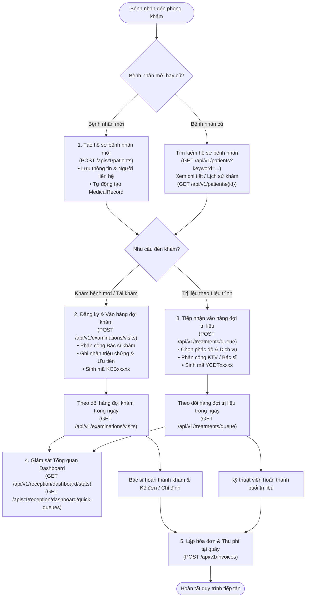

# BÁO CÁO CÔNG VIỆC THỰC HIỆN - HỆ THỐNG API COSGENIUSSYSTEM

> **Dự án:** COSGeniusSystem (Hệ thống quản lý phòng khám đông y & dược liệu)  
> **Người thực hiện:** Phúc
> **Nền tảng:** .NET 10 (ASP.NET Core Web API), Entity Framework Core (SQL Server & InMemory)  
> **Phân hệ phụ trách:** Toàn diện Luồng Tiếp tân (Receptionist Workflow) & Bác sĩ - Dịch vụ Trị liệu  
> **Cập nhật lần cuối:** 29/10/2026  

---

## I. TỔNG QUAN CÔNG VIỆC ĐÃ HOÀN THÀNH

1. **Kết nối Cơ sở dữ liệu & Rà soát hiện trạng (Bước 0):**
   - Rà soát cấu trúc mã nguồn trong solution: xác nhận `ApplicationDbContext` kết nối cơ sở dữ liệu `ClinicHerbManagementDB`.
   - Xác nhận và bảo toàn các mapping có sẵn của entity `Patient` (`PatientCode`, `PatientContacts`), `ExamSheet`, `UsageHistory`, `MedicalRecord`, `TreatmentProtocol`, `RemedyFormula`, `FormulaDetail`.
   - Đảm bảo tính tương thích ngược: kế thừa trực tiếp `IPatientService` và `PatientsController` hỗ trợ đồng thời cả route chuẩn mới `/api/v1/patients` và route hiện hành của nhóm `/api/patients`.

2. **Triển khai Trọn bộ 4 Module Nghiệp vụ Cốt lõi của Phân hệ Tiếp tân:**
   - **Module 1 - Quản lý Hồ sơ Bệnh nhân (Patients):** Cung cấp bộ API tìm kiếm tương đối không phân trang (trả về mảng thuần túy), xem chi tiết mở rộng kèm người liên hệ, lịch sử khám bệnh, chi tiết phiếu khám gồm thông tin khám + dịch vụ chỉ định + đơn thuốc/vị thuốc, danh sách phác đồ và các buổi trị liệu đã thực hiện.
   - **Module 2 - Đăng ký & Hàng đợi Khám bệnh (Examinations):** Quản lý lượt đăng ký khám và hàng đợi trong ngày, phân công bác sĩ, gắn cờ ưu tiên (`IsPriority`), tự động khởi tạo hồ sơ bệnh án `MedicalRecord` mặc định nếu bệnh nhân chưa có và cấp mã khám bệnh `KCBxxxxx`.
   - **Module 3 - Tiếp nhận & Hàng đợi Trị liệu Liệu trình (Treatments):** Quản lý hàng đợi tiếp nhận điều trị theo phác đồ, tự động tính toán và hiển thị tiến độ buổi (dạng `"Buổi 03 / 05"`), tiếp nhận yêu cầu điều trị mới và cấp mã `YCDTxxxxx`.
   - **Module 4 - Tổng quan Tiếp tân (Reception Dashboard):** Cung cấp 4 thẻ thống kê số liệu tổng quan trong ngày (tổng tiếp nhận, chờ khám, chờ trị liệu, hoàn tất, phân rã ca mới/điều trị) và 2 danh sách thu gọn (Quick Queues) cho trang chủ tiếp tân.

3. **Tích hợp các Module Có sẵn vào Luồng Tiếp tân:**
   - Kết nối danh mục Bác sĩ (`/api/v1/doctors`) phục vụ phân công khám bệnh.
   - Kết nối Bảng giá Dịch vụ trị liệu (`/api/v1/services`) phục vụ chỉ định điều trị.
   - Kết nối Người liên hệ bệnh nhân (`/api/patients/{id}/contacts`).
   - Kết nối Hóa đơn & Thu ngân (`/api/v1/invoices`) phục vụ thu viện phí sau khám/trị liệu.

4. **Tuân thủ Quy chuẩn Kiến trúc & Ràng buộc Kỹ thuật:**
   - Mô hình Layered (Feature-based): `Controllers/` $\rightarrow$ `Services/<Module>/` $\rightarrow$ `ApplicationDbContext`.
   - Không tạo tầng Repository trung gian, không tạo Middleware hay Custom Exception ngoài cấu trúc hiện hành.
   - Toàn bộ query đọc dữ liệu đều sử dụng tối ưu hóa `.AsNoTracking()`.
   - Chuẩn hóa mã hóa nghiệp vụ: Mã BN (`PatientCode` hoặc `BN{id:D5}`), Mã khám (`KCB{id:D5}`), Mã bệnh án (`MR{id:D5}`), Mã phác đồ (`LT{id:D5}`), Mã yêu cầu điều trị (`YCDT{id:D5}`).

5. **Xây dựng Bộ Kiểm thử Tự động Unit Test (xUnit & EF Core InMemory):**
   - Viết toàn diện 16 test cases mới cho 4 module Tiếp tân (7 Patient, 4 Examination, 3 Treatment, 2 Dashboard).
   - Tổng cộng **48/48 test cases** trong solution đạt **PASS 100%**.

---

## II. BẢN ĐỒ QUY TRÌNH NGHIỆP VỤ LUỒNG TIẾP TÂN (RECEPTIONIST WORKFLOW)



---

## III. BẢNG TỔNG HỢP TOÀN BỘ API THEO TỪNG MODULE TRONG LUỒNG TIẾP TÂN

Dưới đây là bảng tổng hợp toàn bộ các API tham gia vào phân hệ Tiếp tân, bao gồm cả các API có sẵn được tích hợp và các API mới xây dựng/nâng cấp:

| STT | Luồng / Module nghiệp vụ | Phương thức | Tuyến đường API (Endpoint) | Mục đích nghiệp vụ trong luồng tiếp tân | Tình trạng |
| :---: | :--- | :---: | :--- | :--- | :---: |
| **1** | **TỔNG QUAN TIẾP TÂN (DASHBOARD)** | | | | |
| 1.1 | Thống kê Dashboard | `GET` | `/api/v1/reception/dashboard/stats` | Thống kê 4 thẻ chỉ số trong ngày (tiếp nhận, chờ khám, chờ trị liệu, hoàn tất) và phân rã lượt | **Mới tạo** |
| 1.2 | Hàng đợi nhanh Dashboard | `GET` | `/api/v1/reception/dashboard/quick-queues` | Lấy danh sách thu gọn Top 3 ca chờ khám và Top 3 ca chờ trị liệu hiển thị trang chủ | **Mới tạo** |
| **2** | **HỒ SƠ BỆNH NHÂN (PATIENTS)** | | | | |
| 2.1 | Danh sách bệnh nhân | `GET` | `/api/v1/patients` | Tra cứu, tìm kiếm tương đối hồ sơ bệnh nhân theo Mã BN, Tên, Số điện thoại (trả mảng thuần túy) | **Mới tạo / Nâng cấp** |
| 2.2 | Chi tiết bệnh nhân | `GET` | `/api/v1/patients/{id}` | Xem chi tiết hồ sơ bệnh nhân mở rộng (CCCD, địa chỉ, nghề nghiệp...) và danh sách người liên hệ | **Mới tạo / Nâng cấp** |
| 2.3 | Tạo hồ sơ bệnh nhân | `POST` | `/api/v1/patients` | Đón tiếp bệnh nhân mới: lưu hồ sơ, lưu người liên hệ, tự động tạo bệnh án `MedicalRecord` | **Mới tạo / Nâng cấp** |
| 2.4 | Cập nhật hồ sơ bệnh nhân | `PUT` | `/api/v1/patients/{id}` | Cập nhật thông tin hành chính của bệnh nhân và bổ sung/chỉnh sửa người liên hệ | **Mới tạo / Nâng cấp** |
| 2.5 | Xóa hồ sơ bệnh nhân | `DELETE` | `/api/v1/patients/{id}` | Xóa hồ sơ bệnh nhân khi nhập sai (chỉ xóa được khi chưa phát sinh phiếu khám/liên hệ) | Có sẵn / Tương thích |
| 2.6 | Lịch sử khám bệnh | `GET` | `/api/v1/patients/{id}/visit-history` | Xem lịch sử các lượt khám bệnh trước đây của bệnh nhân (kèm mã `KCB`, mã `MR`, bác sĩ) | **Mới tạo** |
| 2.7 | Chi tiết phiếu khám | `GET` | `/api/v1/patients/exam-sheets/{examSheetId}` | Xem chi tiết phiếu khám: chẩn đoán, mạch, lưỡi, dịch vụ chỉ định (`UsageHistory`) và đơn thuốc/vị thuốc | **Mới tạo** |
| 2.8 | Danh sách phác đồ | `GET` | `/api/v1/patients/{id}/treatment-protocols` | Lấy danh sách phác đồ của bệnh nhân, tự động tính số buổi đã thực hiện và tổng số buổi | **Mới tạo** |
| 2.9 | Chi tiết buổi trị liệu | `GET` | `/api/v1/patients/treatment-protocols/{protocolId}/sessions` | Xem chi tiết tiến độ các buổi trị liệu đã thực hiện của phác đồ (thời gian, dịch vụ, KTV, kết quả) | **Mới tạo** |
| 2.10 | Danh sách người liên hệ | `GET` | `/api/patients/{patientId}/contacts` | Xem danh sách người liên hệ đại diện của bệnh nhân | Có sẵn |
| 2.11 | Thêm người liên hệ | `POST` | `/api/patients/{patientId}/contacts` | Thêm người thân/người giám hộ cho bệnh nhân | Có sẵn |
| 2.12 | Xem người liên hệ | `GET` | `/api/patients/{patientId}/contacts/{contactId}` | Xem chi tiết 1 người liên hệ | Có sẵn |
| 2.13 | Sửa người liên hệ | `PUT` | `/api/patients/{patientId}/contacts/{contactId}` | Cập nhật thông tin người liên hệ | Có sẵn |
| 2.14 | Xóa người liên hệ | `DELETE` | `/api/patients/{patientId}/contacts/{contactId}` | Xóa người liên hệ | Có sẵn |
| **3** | **ĐĂNG KÝ & HÀNG ĐỢI KHÁM (EXAMINATIONS)** | | | | |
| 3.1 | Danh sách hàng đợi khám | `GET` | `/api/v1/examinations/visits` | Lấy danh sách hàng đợi khám trong ngày (sắp xếp ưu tiên lên đầu, lọc theo BS, từ khóa, trạng thái) | **Mới tạo** |
| 3.2 | Đăng ký khám mới | `POST` | `/api/v1/examinations/visits` | Đăng ký khám: tự động gắn `MedicalRecord`, phân công BS, gán cờ ưu tiên, tạo phiếu `KCBxxxxx` | **Mới tạo** |
| 3.3 | Chi tiết phiếu đăng ký | `GET` | `/api/v1/examinations/visits/{examSheetId}` | Xem chi tiết phiếu đăng ký khám theo `ExamSheetID` | **Mới tạo** |
| 3.4 | Hủy phiếu khám | `DELETE` | `/api/v1/examinations/visits/{examSheetId}` | Hủy lượt đăng ký khám khi bệnh nhân bỏ về (áp dụng khi đang `"Chờ khám"`) | **Mới tạo** |
| 3.5 | Danh mục Bác sĩ khám | `GET` | `/api/v1/doctors` | Lấy danh mục bác sĩ đang hoạt động theo chuyên khoa để tiếp tân phân công phòng khám | Có sẵn / Tích hợp |
| 3.6 | Chi tiết Bác sĩ | `GET` | `/api/v1/doctors/{id}` | Xem chi tiết thông tin và chuyên môn của bác sĩ | Có sẵn / Tích hợp |
| **4** | **TIẾP NHẬN & HÀNG ĐỢI TRỊ LIỆU (TREATMENTS)** | | | | |
| 4.1 | Hàng đợi chờ trị liệu | `GET` | `/api/v1/treatments/queue` | Lấy danh sách chờ trị liệu hôm nay, hiển thị tiến độ buổi liệu trình (dạng `"Buổi 03 / 05"`) | **Mới tạo** |
| 4.2 | Tiếp nhận điều trị | `POST` | `/api/v1/treatments/queue` | Tiếp nhận bệnh nhân vào hàng đợi trị liệu, gắn vào phiếu khám, tạo `UsageHistory`, cấp mã `YCDTxxxxx` | **Mới tạo** |
| 4.3 | Danh mục bảng giá dịch vụ | `GET` | `/api/v1/services` | Tra cứu danh mục dịch vụ trị liệu khả dụng (Châm cứu, Bấm huyệt, Cứu ngải...) và đơn giá | Có sẵn / Tích hợp |
| **5** | **HÓA ĐƠN & THU PHÍ TẠI QUẦY (INVOICES)** | | | | |
| 5.1 | Danh sách hóa đơn | `GET` | `/api/v1/invoices` | Lấy danh sách hóa đơn viện phí tại quầy thu ngân | Có sẵn / Tích hợp |
| 5.2 | Chi tiết hóa đơn | `GET` | `/api/v1/invoices/{id}` | Xem chi tiết hóa đơn thanh toán (chi phí khám, dịch vụ trị liệu, tiền thuốc thang) | Có sẵn / Tích hợp |
| 5.3 | Lập hóa đơn | `POST` | `/api/v1/invoices` | Tạo hóa đơn thanh toán viện phí cho bệnh nhân sau khám/trị liệu | Có sẵn / Tích hợp |

---

## IV. CẤU TRÚC FILE MÃ NGUỒN CÁC MODULE VỪA TRIỂN KHAI

```text
COSGeniusSystem/
├── Controllers/
│   ├── PatientsController.cs                          # Module 1: Quản lý hồ sơ bệnh nhân (Nâng cấp)
│   ├── ExaminationsController.cs                      # Module 2: Đăng ký & Hàng đợi khám bệnh (Mới)
│   ├── TreatmentsController.cs                        # Module 3: Tiếp nhận & Hàng đợi trị liệu (Mới)
│   └── ReceptionDashboardController.cs                # Module 4: Tổng quan Dashboard tiếp tân (Mới)
├── DTOs/
│   ├── Patients/                                      # DTOs Module 1: Hồ sơ bệnh nhân
│   │   ├── PatientSearchQuery.cs                      # Tham số tìm kiếm bệnh nhân tương đối
│   │   ├── PatientResponseDto.cs                      # Output mảng bệnh nhân thuần túy
│   │   ├── PatientDetailDto.cs                        # Output chi tiết bệnh nhân kèm người liên hệ
│   │   ├── PatientContactDto.cs                       # Thông tin người liên hệ
│   │   ├── CreatePatientRequest.cs                    # Input tạo bệnh nhân + liên hệ đại diện
│   │   ├── UpdatePatientRequest.cs                    # Input cập nhật bệnh nhân + danh sách liên hệ
│   │   ├── PatientVisitHistoryDto.cs                  # Output lịch sử các lần khám
│   │   ├── MedicalRecordDetailDto.cs                  # Output chi tiết phiếu khám, dịch vụ, đơn thuốc
│   │   ├── TreatmentProtocolDto.cs                    # Output danh sách phác đồ & số buổi hoàn tất
│   │   └── TreatmentSessionDto.cs                     # Output chi tiết các buổi trị liệu
│   ├── Examinations/                                  # DTOs Module 2: Khám bệnh
│   │   ├── ExaminationFilterQuery.cs                  # Tham số lọc hàng đợi khám
│   │   ├── ExaminationVisitDto.cs                     # Output phiếu khám trong hàng đợi
│   │   └── CreateExaminationVisitRequest.cs           # Input đăng ký lượt khám bệnh mới
│   ├── Treatments/                                    # DTOs Module 3: Trị liệu
│   │   ├── TreatmentQueueQuery.cs                     # Tham số lọc hàng đợi trị liệu
│   │   ├── TreatmentQueueDto.cs                       # Output hàng đợi trị liệu kèm tiến độ buổi
│   │   └── CreateTreatmentRequest.cs                  # Input tiếp nhận lượt trị liệu mới
│   └── Reception/                                     # DTOs Module 4: Tổng quan Dashboard
│       ├── DashboardStatsDto.cs                       # Output 4 chỉ số thống kê & phân rã trong ngày
│       └── DashboardQueueDto.cs                       # Output Top ca chờ khám & chờ trị liệu trang chủ
├── Services/
│   ├── Interfaces/
│   │   └── IPatientService.cs                         # Interface Module 1 (Mở rộng 8 phương thức)
│   ├── PatientService.cs                              # Hiện thực Service Module 1
│   ├── Examinations/
│   │   ├── IExaminationService.cs                     # Interface Module 2 (kèm alias IExamSheetService)
│   │   └── ExaminationService.cs                      # Hiện thực Service Module 2
│   ├── Treatments/
│   │   ├── ITreatmentProtocolService.cs               # Interface Module 3 (kèm alias ITreatmentQueueService)
│   │   └── TreatmentProtocolService.cs                # Hiện thực Service Module 3
│   └── Reception/
│       ├── IReceptionDashboardService.cs              # Interface Module 4: Dashboard
│       └── ReceptionDashboardService.cs               # Hiện thực Service Module 4
├── UnitTests/
│   ├── Patients/
│   │   └── PatientServiceTests.cs                     # 7 Unit Tests kiểm thử Module 1
│   ├── Examinations/
│   │   └── ExaminationServiceTests.cs                 # 4 Unit Tests kiểm thử Module 2
│   ├── Treatments/
│   │   └── TreatmentProtocolServiceTests.cs           # 3 Unit Tests kiểm thử Module 3
│   └── Reception/
│       └── ReceptionDashboardServiceTests.cs          # 2 Unit Tests kiểm thử Module 4
├── Commons/
│   └── SystemMessages.cs                              # Bổ sung các thông điệp phản hồi chuẩn hóa
└── Program.cs                                         # Đăng ký Dependency Injection AddScoped
```

---

## V. ĐẶC TẢ CHI TIẾT TỪNG API TRONG LUỒNG TIẾP TÂN

### 1. MODULE 1: HỒ SƠ & THÔNG TIN BỆNH NHÂN

#### API-RECEPT-01: Lấy danh sách hồ sơ bệnh nhân
* **Method & URL:** `GET /api/v1/patients` (hoặc `GET /api/patients`)
* **Query Parameters (`PatientSearchQuery`):**
  * `keyword` *(string, optional)*: Tìm kiếm tương đối không phân biệt hoa thường theo `PatientCode`, `FullName` hoặc `Phone`.
* **Logic:** Dùng `.AsNoTracking()`, sắp xếp giảm dần theo `PatientId`, chuẩn hóa mã `PatientCode ?? $"BN{p.PatientId:D5}"`.
* **Output:** `200 OK` kèm `List<PatientResponseDto>`. Trả về danh sách mảng thuần túy để UI Client tự phân trang.

#### API-RECEPT-02: Xem chi tiết bệnh nhân kèm người liên hệ
* **Method & URL:** `GET /api/v1/patients/{id}` (hoặc `GET /api/patients/{id}`)
* **Route Parameter:** `id` *(int)*: Khóa chính `PatientId`.
* **Logic:** Truy vấn bệnh nhân kết hợp `.Include(p => p.PatientContacts)`. Nếu không tìm thấy, trả về `404 Not Found`.
* **Output:** `200 OK` kèm `PatientDetailDto` gồm toàn bộ thông tin cá nhân mở rộng (CCCD, ngày cấp, nơi cấp, nghề nghiệp, nơi làm việc, dân tộc, quốc tịch...) và danh sách người liên hệ từ bảng `PatientContact`.

#### API-RECEPT-03: Thêm mới hồ sơ bệnh nhân
* **Method & URL:** `POST /api/v1/patients` (hoặc `POST /api/patients`)
* **Request Body (`CreatePatientRequest`):** Thông tin cá nhân bệnh nhân kèm thông tin người liên hệ đại diện ban đầu (`ContactFullName`, `ContactRelationship`, `ContactPhone`).
* **Logic:**
  * Validate ngày sinh và ngày cấp CCCD không được vượt quá ngày hiện tại.
  * Lưu vào bảng `Patient`. Nếu có thông tin người liên hệ, lưu tiếp vào `PatientContact`.
  * **Tự động khởi tạo 1 bản ghi `MedicalRecord` mặc định** gắn với `PatientId` với `Status = N'Đang theo dõi'` và `CreatedDate = DateTime.Now`.
* **Output:** `201 Created` kèm thông tin chi tiết bệnh nhân vừa tạo.

#### API-RECEPT-04: Cập nhật hồ sơ bệnh nhân
* **Method & URL:** `PUT /api/v1/patients/{id}` (hoặc `PUT /api/patients/{id}`)
* **Request Body (`UpdatePatientRequest`):** Thông tin hành chính cập nhật và danh sách người liên hệ cần cập nhật hoặc thêm mới.
* **Logic:** Cập nhật các trường thông tin bệnh nhân; duyệt danh sách `Contacts`: nếu có `ContactId` thì cập nhật, nếu không có thì thêm mới vào `PatientContact`.
* **Output:** `200 OK` kèm thông tin chi tiết bệnh nhân sau cập nhật.

#### API-RECEPT-05: Lịch sử các lần khám bệnh của bệnh nhân
* **Method & URL:** `GET /api/v1/patients/{id}/visit-history`
* **Route Parameter:** `id` *(int)*: Khóa chính `PatientId`.
* **Logic:** Truy vấn các phiếu khám `ExamSheet` liên kết thông qua `MedicalRecord` của bệnh nhân, sắp xếp giảm dần theo ngày khám `ExamDate`.
* **Output:** `200 OK` kèm `List<PatientVisitHistoryDto>` (Mã `KCB{ExamSheetId:D5}`, mã `MR{RecordId:D5}`, bác sĩ, triệu chứng, trạng thái).

#### API-RECEPT-06: Chi tiết một lần khám bệnh
* **Method & URL:** `GET /api/v1/patients/exam-sheets/{examSheetId}`
* **Route Parameter:** `examSheetId` *(int)*: Khóa chính `ExamSheetId`.
* **Logic:** Truy vấn chi tiết `ExamSheet` kèm bác sĩ, các dịch vụ chỉ định từ `UsageHistory` và các đơn thuốc từ `RemedyFormula` kèm chi tiết từng vị thuốc trong `FormulaDetail`.
* **Output:** `200 OK` kèm `MedicalRecordDetailDto`:
  * Thông tin khám: Bác sĩ, ngày giờ khám, chẩn đoán xác định, triệu chứng, mạch chẩn, thiệt chẩn, lời dặn bác sĩ.
  * Danh sách dịch vụ chỉ định (`UsageHistoryItemDto`): Mã `YCDTxxxxx`, tên dịch vụ, số lượng, thời gian thực hiện, bác sĩ/KTV thực hiện, ghi chú kết quả.
  * Đơn thuốc (`PrescriptionDto`): Tên bài thuốc, hướng dẫn sử dụng, số ngày uống, tổng số thang và danh sách vị thuốc (`FormulaDetailItemDto` gồm tên dược liệu, liều lượng/thang, vai trò Quân/Thần/Tá/Sứ).

#### API-RECEPT-07: Danh sách phác đồ / liệu trình điều trị
* **Method & URL:** `GET /api/v1/patients/{id}/treatment-protocols`
* **Route Parameter:** `id` *(int)*: Khóa chính `PatientId`.
* **Logic:** Lấy danh sách `TreatmentProtocol` của bệnh nhân. Tính toán `CompletedSessions` dựa trên số lượng bản ghi `UsageHistory` tương ứng; bóc tách `TotalSessions` từ mô tả phác đồ (mặc định 10); xác định trạng thái `"Đang điều trị"`, `"Đã hoàn thành"` hoặc `"Mới tiếp nhận"`.
* **Output:** `200 OK` kèm `List<TreatmentProtocolDto>`.

#### API-RECEPT-08: Chi tiết các buổi trị liệu của phác đồ
* **Method & URL:** `GET /api/v1/patients/treatment-protocols/{protocolId}/sessions`
* **Route Parameter:** `protocolId` *(int)*: Khóa chính `ProtocolId`.
* **Logic:** Lấy danh sách các buổi trị liệu đã ghi nhận trong `UsageHistory` thuộc bệnh án của phác đồ, sắp xếp theo thời gian thực hiện.
* **Output:** `200 OK` kèm `List<TreatmentSessionDto>`: Thứ tự buổi `SessionNo` (1, 2, 3...), thời gian, tên dịch vụ, người thực hiện, ghi chú kết quả, trạng thái (`"Chờ điều trị"` hoặc `"Đã hoàn thành"`).

---

### 2. MODULE 2: ĐĂNG KÝ & HÀNG ĐỢI KHÁM BỆNH

#### API-RECEPT-09: Lấy danh sách đăng ký khám & hàng đợi khám
* **Method & URL:** `GET /api/v1/examinations/visits`
* **Query Parameters (`ExaminationFilterQuery`):** `FromDate`, `ToDate`, `DoctorId`, `Keyword`, `Status`. Mặc định lấy theo ngày hiện tại (`DateTime.Today`).
* **Logic:** Lọc phiếu khám theo khoảng thời gian; ưu tiên hiển thị các ca cấp cứu/người già (`IsPriority == true`) lên trước, sau đó theo thứ tự thời gian đến; đánh số thứ tự `Stt`.
* **Output:** `200 OK` kèm `List<ExaminationVisitDto>` (`Stt`, `KcbCode`, `PatientCode`, `PatientName`, `RegisteredDate`, `DoctorName`, `IsPriority`, `Phone`, `Status`).

#### API-RECEPT-10: Đăng ký lượt khám bệnh mới vào hàng đợi
* **Method & URL:** `POST /api/v1/examinations/visits`
* **Request Body (`CreateExaminationVisitRequest`):** `PatientId`, `DoctorId`, `Symptoms`, `DoctorAdvice`, `IsPriority`.
* **Logic:**
  * Lấy `RecordId` từ `MedicalRecord` đang hoạt động của bệnh nhân (nếu chưa có thì tự động tạo mới `MedicalRecord`).
  * Nếu là ca ưu tiên (`IsPriority == true`), tự động gắn tiền tố `[Ưu tiên]` vào triệu chứng.
  * Thêm bản ghi mới vào `ExamSheet` với `ExamDate = DateTime.Now`, `DoctorId`, `Symptoms`, và gán `FinalDiagnosis = N'Chờ khám'`.
* **Output:** `201 Created` kèm thông tin phiếu khám và mã lượt khám vừa sinh `KCBxxxxx`.

#### API-RECEPT-11: Xem chi tiết phiếu đăng ký khám
* **Method & URL:** `GET /api/v1/examinations/visits/{examSheetId}`
* **Route Parameter:** `examSheetId` *(int)*: Khóa chính `ExamSheetId`.
* **Output:** `200 OK` kèm `ExaminationVisitDto`.

#### API-RECEPT-12: Hủy lượt đăng ký khám khi bệnh nhân bỏ về
* **Method & URL:** `DELETE /api/v1/examinations/visits/{examSheetId}`
* **Logic:** Kiểm tra phiếu khám còn ở trạng thái `"Chờ khám"`. Nếu chưa có hóa đơn, đơn thuốc hay dịch vụ trị liệu liên quan thì xóa hoàn toàn bản ghi; nếu đã có liên kết thì cập nhật trạng thái `"Đã hủy"`.
* **Output:** `200 OK` kèm thông báo hủy thành công.

---

### 3. MODULE 3: TIẾP NHẬN & HÀNG ĐỢI TRỊ LIỆU THEO LIỆU TRÌNH

#### API-RECEPT-13: Lấy danh sách hàng đợi chờ trị liệu hôm nay
* **Method & URL:** `GET /api/v1/treatments/queue`
* **Query Parameters (`TreatmentQueueQuery`):** `Date` (mặc định hôm nay), `DoctorId`, `Keyword`.
* **Logic:** Truy vấn danh sách `UsageHistory` trong ngày mà `ResultNote` còn trống hoặc là `"Chờ điều trị"`. Tự động tính toán tiến độ buổi `SessionInfo` dạng `"Buổi 03 / 05"` dựa trên số lần trị liệu đã ghi nhận trong hồ sơ bệnh án.
* **Output:** `200 OK` kèm `List<TreatmentQueueDto>` (`Stt`, `UsageId`, `PatientName`, `PatientCode`, `Phone`, `YcdtCode`, `ReceptionTime`, `ProtocolName`, `SessionInfo`, `DoctorName`, `Status = "Chờ điều trị"`).

#### API-RECEPT-14: Tiếp nhận bệnh nhân vào hàng đợi điều trị
* **Method & URL:** `POST /api/v1/treatments/queue`
* **Request Body (`CreateTreatmentRequest`):** `PatientId`, `ServiceId`, `DoctorId`, `ExamSheetId` (optional), `Note`.
* **Logic:**
  * Xác định `ExamSheetId` hợp lệ gần nhất của bệnh nhân (hoặc tự động tạo hồ sơ bệnh án và phiếu tiếp nhận nếu bệnh nhân vào trị liệu thẳng).
  * Thêm mới một bản ghi vào `UsageHistory` với `ServiceID`, `PerformedBy = DoctorId`, `ExecutionTime = DateTime.Now`, `Quantity = 1`, `ResultNote = Note`.
* **Output:** `201 Created` kèm thông tin lượt trị liệu và mã yêu cầu điều trị `YCDTxxxxx`.

---

### 4. MODULE 4: TỔNG QUAN TIẾP TÂN (RECEPTION DASHBOARD)

#### API-RECEPT-15: Lấy số liệu thống kê tổng quan trong ngày
* **Method & URL:** `GET /api/v1/reception/dashboard/stats`
* **Logic:**
  * Đếm tổng lượt tiếp nhận `TodayTotalVisits` (tổng ca khám mới + ca điều trị).
  * Đếm ca chờ khám `WaitingExaminationCount` (`FinalDiagnosis == "Chờ khám"`).
  * Đếm ca chờ điều trị `WaitingTreatmentCount` (`ResultNote` rỗng / `"Chờ điều trị"`).
  * Đếm ca hoàn tất `CompletedVisitsCount` (đã khám xong + đã điều trị xong).
  * Phân rã số ca khám mới `NewExaminationCount` và số ca điều trị `TreatmentCount`.
* **Output (`200 OK`):**
  ```json
  {
    "code": 200,
    "message": "Dashboard stats retrieved successfully.",
    "isSuccess": true,
    "data": {
      "todayTotalVisits": 28,
      "waitingExaminationCount": 6,
      "waitingTreatmentCount": 4,
      "completedVisitsCount": 18,
      "newExaminationCount": 16,
      "treatmentCount": 12
    }
  }
  ```

#### API-RECEPT-16: Lấy danh sách 2 hàng đợi thu gọn hiển thị trang chủ
* **Method & URL:** `GET /api/v1/reception/dashboard/quick-queues?top=3`
* **Query Parameters:** `top` *(int, default = 3)*: Số lượng ca chờ lấy ra ở đầu mỗi hàng đợi.
* **Logic:**
  * Top ca chờ khám: sắp xếp ưu tiên `IsPriority` lên đầu, sau đó theo thời gian đến.
  * Top ca chờ điều trị: sắp xếp theo thời gian tiếp nhận và format tiến độ buổi `"02 / 05"`.
* **Output (`200 OK`):**
  ```json
  {
    "code": 200,
    "message": "Dashboard quick queues retrieved successfully.",
    "isSuccess": true,
    "data": {
      "waitingExaminations": [
        {
          "stt": 1,
          "examSheetId": 105,
          "kcbCode": "KCB00105",
          "patientCode": "BN00021",
          "fullName": "Nguyễn Văn An",
          "doctorName": "BS. CKI Nguyễn Văn Tuấn",
          "receptionTime": "2026-10-29T08:15:00",
          "isPriority": true
        }
      ],
      "waitingTreatments": [
        {
          "stt": 1,
          "usageId": 88,
          "ycdtCode": "YCDT00088",
          "patientCode": "BN00015",
          "fullName": "Trần Thị Bình",
          "protocolOrServiceName": "Phác đồ phục hồi thoái hóa cột sống",
          "doctorName": "KTV. Lê Văn C",
          "sessionInfo": "03 / 05",
          "receptionTime": "2026-10-29T08:30:00"
        }
      ]
    }
  }
  ```

---